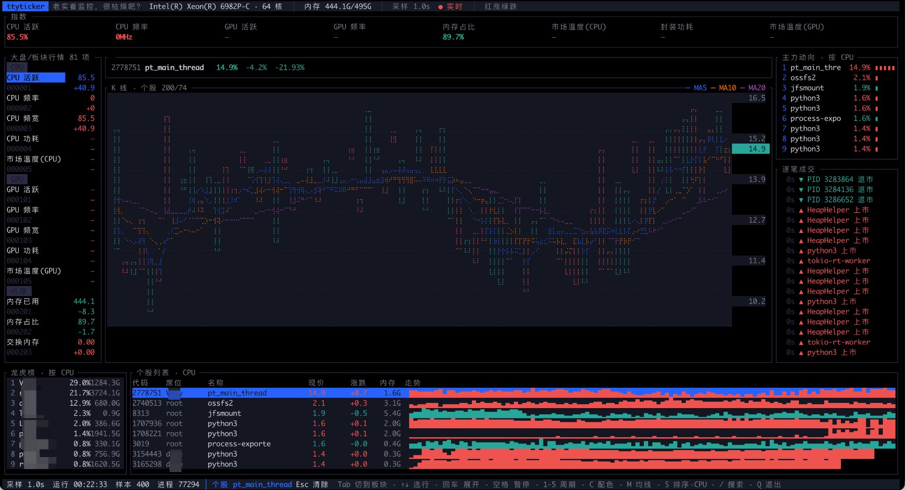

# ttyticker

> 老实看监控，很枯燥吧？

把系统指标做成证券行情终端的终端版。CPU、GPU、内存、功耗每一项都是一只「个股」，
有交易所风格的代码、实时 K 线、均线、量柱；进程是成分股，按属主聚合成龙虎榜。



上图是 Linux 服务器上的实机效果：Intel Xeon 6982P-C 64 核 495G 内存，
主图锁定在 `pt_main_thread` 这个进程上。
GPU 与温度显示 `—` 是因为虚拟机没有对应传感器，不是读数为零。
龙虎榜的席位名做了脱敏，实际运行显示的是机器上的真实用户名。

## 界面

```
┌ 标题栏  芯片 · 核心数 · 采样周期 · 配色 · 焦点提示 ────────────────┐
├ 指数条  八格：CPU 活跃 / 频率 / GPU / 内存 / 温度 / 功耗 ──────────┤
├───────────┬────────────────────────────┬─────────────────────────┤
│ 大盘/板块  │ 品种头  代码 名称 现价 涨跌  │ 主力动向  Top 10 进程   │
│ 行情       │ K 线主图 + 均线 + 量柱      │ 逐笔成交  事件流水      │
│ 28 项      │ 右侧价格轴                 │                         │
├───────────┴────────────────────────────┴─────────────────────────┤
│ 龙虎榜  资源占用前十的席位 │ 个股列表  进程表，按席位可过滤       │
├──────────────────────────────────────────────────────────────────┤
│ 状态栏  采样 · 运行 · 样本 · 进程 · 按键提示                     │
└──────────────────────────────────────────────────────────────────┘
```

## 快速开始

已安装 Rust 1.95 或更高版本、Git 和系统编译工具的话，可以直接从源码编译：

```bash
git clone https://github.com/jzlikewei/ttyticker.git
cd ttyticker
cargo build --release --locked
./target/release/ttyticker
```

**或者直接使用预编译好的二进制**，无需安装 Rust：前往
[Releases](https://github.com/jzlikewei/ttyticker/releases)，按操作系统和 CPU 架构下载附件。
具体命令见下方「使用预编译二进制」。

## 系统要求

| | 要求 |
|---|---|
| macOS | **Apple Silicon**（M1 及以上）；采集依赖 IOReport 等系统接口，当前不支持 Intel Mac |
| Linux | x86_64 或 aarch64；采集依赖 `/proc` 与 `/sys`，具体硬件指标取决于驱动和读取权限 |
| Windows | 当前不支持 |
| 终端 | 交互式终端，至少 **100 列**；建议 150 列 × 42 行，并使用能显示中文与 Braille 字符的字体 |
| 源码编译 | Rust **1.95 或更高**、Cargo、Git，以及系统 C 编译器/链接器；使用预编译二进制时不需要这些工具 |

最低 Rust 版本由当前依赖决定：`sysinfo 0.40.1` 要求 1.95，不能只按 Rust 2024 edition
的最低版本 1.85 判断。`Cargo.toml` 中的 `rust-version` 与此保持一致。

通常以普通用户运行即可，无需 sudo。Linux 的部分硬件指标可能因权限或驱动而不可用。
程序仍依赖操作系统提供的库；macOS 版本会动态链接 IOKit、IOReport 等系统库，
并非完全静态的二进制。

## 使用预编译二进制

[v0.1.0](https://github.com/jzlikewei/ttyticker/releases/tag/v0.1.0) 提供以下附件；
后续版本与附件以 [Releases](https://github.com/jzlikewei/ttyticker/releases) 页面为准：

| 平台 | 下载文件 |
|---|---|
| macOS Apple Silicon（arm64） | [ttyticker-macos-arm64](https://github.com/jzlikewei/ttyticker/releases/download/v0.1.0/ttyticker-macos-arm64) |
| Linux x86_64 | [ttyticker-linux-x86_64](https://github.com/jzlikewei/ttyticker/releases/download/v0.1.0/ttyticker-linux-x86_64) |

这些附件是可执行文件，无需解压。在终端进入下载目录后，按平台运行：

```bash
# macOS Apple Silicon
chmod +x ./ttyticker-macos-arm64
./ttyticker-macos-arm64
```

```bash
# Linux x86_64
chmod +x ./ttyticker-linux-x86_64
./ttyticker-linux-x86_64
```

可用 `uname -m` 查看 CPU 架构。v0.1.0 暂无 Linux aarch64 附件，请从源码编译。
如果 Linux 提示 `GLIBC_* not found`，说明预编译文件与本机系统库不兼容，请在本机编译。
下文命令使用源码构建路径；使用下载的二进制时，将 `./target/release/ttyticker` 替换为对应文件路径。

## 从源码编译

### 1. 安装系统编译工具

macOS 安装 Xcode Command Line Tools（已安装则跳过）：

```bash
xcode-select --install
```

Linux 安装 Git、C 编译器和链接器，例如 Debian / Ubuntu：

```bash
sudo apt update
sudo apt install -y build-essential git curl ca-certificates
```

其他发行版请用对应包管理器安装等效工具。安装系统软件可能需要管理员权限，运行 ttyticker 本身通常不需要。

### 2. 安装或更新 Rust

尚未安装 Rust：

```bash
curl --proto '=https' --tlsv1.2 -sSf https://sh.rustup.rs | sh -s -- -y --profile minimal
source ~/.cargo/env
```

如果已有通过 rustup 安装的 Rust，但版本低于 1.95：

```bash
rustup update stable
rustup default stable
```

确认当前生效的工具链版本：

```bash
rustc --version
cargo --version
```

国内网络拉取依赖较慢时，可选择配置镜像。将以下配置合并到 `~/.cargo/config.toml`；
若文件已有内容，请保留现有配置，并检查是否已有同名配置节，不要直接覆盖：

```toml
[source.crates-io]
replace-with = "rsproxy-sparse"

[source.rsproxy-sparse]
registry = "sparse+https://rsproxy.cn/index/"
```

### 3. 获取源码并编译

```bash
git clone https://github.com/jzlikewei/ttyticker.git
cd ttyticker
cargo build --release --locked
```

如果已经下载源码，进入包含 `Cargo.toml` 的项目根目录后执行构建命令即可。
首次构建需要联网下载依赖；`--locked` 使用仓库提交的 `Cargo.lock`，避免意外更新依赖版本。

产物在 `target/release/ttyticker`。直接运行这个文件即可，文件大小取决于平台和工具链。
默认构建的是当前系统与架构的程序，并非同时生成所有平台的二进制。

平台依赖分开声明，`macmon` 只在 macOS 上引入，因此 Linux 构建不需要 Apple 框架：

```toml
[target.'cfg(target_os = "macos")'.dependencies]
macmon = { version = "0.10.0", default-features = false }
```

## 运行与基本操作

在项目根目录的交互式终端中启动：

```bash
./target/release/ttyticker
```

默认约每秒采样一次，使用 5 秒 K 线。刚启动时历史数据较少，等待一段时间后图表会逐渐填充。

1. 在「板块」区用上下键选择 CPU、内存等指标，主图显示对应 K 线，同时解除已有的进程锁定。
2. 按 `Tab` 切到「龙虎榜」，选择属主并按回车，按该属主过滤进程；再次回车取消过滤。
3. 再按 `Tab` 切到「个股」，选择进程并按回车，将主图锁定到该进程；再次回车解除锁定。
4. 按 `/` 输入进程名或 PID，再按回车保留搜索条件并恢复快捷键。按 `Esc` 可清空搜索。
5. 非搜索输入状态下，`Esc` 每次清除一层状态，顺序为搜索 → 进程锁定 → 席位过滤；没有这些状态时退出程序。状态栏会提示当前生效的状态。
6. 非搜索输入状态下按小写 `q` 直接退出；`Ctrl+C` 在搜索输入时也可退出。

SSH 使用时，可以先 `ssh host` 登录，再启动程序；也可以显式分配 TTY：

```bash
ssh -t host '/path/to/ttyticker'
```

将 `host` 和程序路径替换为实际值。直接执行 `ssh host ./ttyticker` 通常不会分配交互式 TTY。
需要重定向输出或在无 TTY 环境中运行时，请使用下方诊断模式。

## 按键

**字母快捷键使用小写，不要按 Shift。** 搜索输入期间，字母和空格用于输入搜索词，不触发快捷键。

| 键 | 作用 |
|---|---|
| `Tab` | 三区循环切换焦点：板块 → 龙虎榜 → 个股 |
| `↑` `↓` / `k` `j` | 在当前区移动选中行 |
| `回车` | 龙虎榜：开启 / 取消席位过滤；个股：锁定 / 解除主图进程；搜索输入时：提交搜索并恢复快捷键 |
| `空格` | 暂停 / 继续图表历史更新；后台采集仍继续 |
| `1`–`5` | 切换 K 线周期（2 秒 / 5 秒 / 10 秒 / 30 秒 / 1 分） |
| `c` | 红涨绿跌 ↔ 绿涨红跌 |
| `m` | 均线档位：三条 → 只 MA5 → 关闭 |
| `s` | 焦点在龙虎榜：按 CPU / 内存排序席位；其他区：进程排序 CPU → 内存 → 线程 → PID |
| `/` | 开始或继续编辑进程名 / PID 搜索 |
| `Esc` | 搜索输入时：清空并结束搜索；其他时候：按搜索 → 进程锁定 → 席位过滤的顺序清除一层；无状态可清除时退出 |
| `q` | 非搜索输入状态下退出 |
| `Ctrl+C` | 退出，包括搜索输入状态 |

## 诊断模式

不进入交互界面，可重定向输出。每次只选择一个模式。`--once`、`--demo` 和
`--faults-probe` 仍需要能初始化本机采集器；`--demo` 并非完全离线的模拟模式。
当前没有 `--help` / `--version` 参数，请以本节为准。

| 参数 | 用途与等待时间 |
|---|---|
| `--once` | 累积真实采样后导出一帧 ANSI 文本；默认循环 180 轮，每轮等待 260 ms，约 47 秒后输出，另加初始化耗时 |
| `--demo` | 固定循环 12 轮，每轮等待 220 ms，随后注入多属主样例进程并导出一帧；约 3 秒，另加初始化耗时 |
| `--faults-probe` | 连续采样并输出换页速率等统计；默认 40 轮，每轮约 1 秒 |
| `--grid-test` | 探测 ratatui Canvas 对 Rectangle / Line 的栅格化行为，无需硬件采样 |

可用环境变量：

| 变量 | 适用范围 | 含义 |
|---|---|---|
| `PT_ROUNDS` | 仅 `--once` | 循环轮数，默认 180；轮数较少时图表历史也较少 |
| `PT_COLS` / `PT_ROWS` | `--once`、`--demo` | 导出尺寸；`--once` 默认 **140 × 42**，`--demo` 默认 **150 × 42** |
| `PT_SELECT` | 仅 `--once` | 指定品种代码，如 `000001` |
| `PT_LOCK_SELF` | 仅 `--once` | 设置后主图锁定本进程，优先于 `PT_LOCK_TOP` |
| `PT_LOCK_TOP` | 仅 `--once` | 设置后主图锁定当前进程列表首项（默认按 CPU 排序） |
| `PT_N` | 仅 `--faults-probe` | 采样轮数，默认 40，建议至少 2 |
| `PT_MARKER` | 交互界面、`--once`、`--demo` | 主图栅格化方案：`braille`（默认）/ `block` / `halfblock` / `dot` / `bar` |
| `PT_DEBUG_CHART` | 交互界面、`--once`、`--demo` | 设置后向标准错误打印主图布局数值；建议诊断时使用 |
| `PT_DEBUG_VM` | macOS 硬件采样模式 | 设置后打印 `host_statistics` 原始返回，Linux 不使用 |

开关型变量按「是否设置」判断，设为 `0` 也会启用；不需要时请取消该变量。

快速检查采集与渲染（缩短等待，图表尚不会填满）：

```bash
PT_ROUNDS=12 ./target/release/ttyticker --once > snapshot.ansi
cat snapshot.ansi
```

导出样例进程界面，或进行较短的采样诊断：

```bash
PT_COLS=150 PT_ROWS=42 ./target/release/ttyticker --demo > demo.ansi
PT_N=10 ./target/release/ttyticker --faults-probe
```

ANSI 文件在支持颜色的终端中查看。若需要去掉颜色码转成普通文本，可用 Python 3（仅此转换步骤需要）：

```bash
python3 -c "import re,sys; print(re.sub(r'\x1b\[[0-9;]*m','',sys.stdin.read()))" < snapshot.ansi > snapshot.txt
```

## 常见问题

| 现象 | 处理方式 |
|---|---|
| `cargo: command not found` | 安装 Rust 后执行 `source ~/.cargo/env`，或重新打开终端 |
| 提示 Rust 版本过低 | 更新工具链，并用 `rustc --version` 确认实际生效版本至少为 1.95；检查目录是否设置了旧版本 override |
| 找不到 `cc` / linker，或缺少 macOS SDK | 安装上文的系统编译工具；macOS 可用 `xcode-select -p` 检查开发工具路径 |
| 下载的程序提示 `Permission denied` | 对该文件执行 `chmod +x` |
| `Exec format error` / `Bad CPU type` | 检查文件的平台与 `uname -m` 是否匹配；Intel Mac 当前不支持 |
| Linux 提示 `GLIBC_* not found` | 在目标机器从源码编译，或使用与二进制兼容的系统 |
| macOS 阻止打开下载的程序 | 确认文件来自本仓库 Release 后，按系统「隐私与安全性」中的提示允许该程序；也可以从源码编译 |
| 无法初始化采集器 | macOS 确认是 Apple Silicon；沙箱或系统接口限制可能阻止 IOReport 采样，可在本机普通终端重试 |
| 界面提示终端过窄、布局拥挤 | 放大终端至至少 100 列，建议 150 × 42；中文或 K 线字符异常时检查字体，或尝试 `PT_MARKER=block` |
| SSH 启动时报 TTY 错误 | 先登录再运行，或使用 `ssh -t`；导出快照则使用 `--once` |
| `--once` 暂时没有输出 | 默认需要约 47 秒，可设置较小的 `PT_ROUNDS` 缩短等待 |
| 搜索后 `q` 不退出 / `Esc` 没有退出 | 输入搜索时 `q` 是搜索词；回车提交后恢复快捷键。`Esc` 先逐层清除搜索、进程锁定和席位过滤；要直接退出用非搜索输入状态下的 `q`，或 `Ctrl+C` |

## 数据来源

| 指标 | macOS | Linux |
|---|---|---|
| CPU 占用（整机 + 逐核） | macmon（IOReport） | `/proc/stat` 两端差分 |
| CPU 频率 | macmon 频率加权驻留 | `cpufreq/scaling_cur_freq`，回退 `/proc/cpuinfo` |
| GPU 活跃 / 频率 / 功耗 / 温度 | macmon | amdgpu 的 `gpu_busy_percent` |
| 内存与 Swap | macmon | `/proc/meminfo` |
| 换页速率（副图成交量） | `host_statistics` 的 `pageins` | `/proc/vmstat` 的 `pgfault` |
| 功耗 | macmon | RAPL `/sys/class/powercap` |
| 温度与风扇 | macmon（SMC） | `/sys/class/hwmon` |
| 进程与属主 | sysinfo | sysinfo |

## 已知限制

**`vm_statistics.faults` 在现代 macOS 上是废弃字段**，内核恒返回 `-1`。缺页速率改用
`pageins`（`faults` 的子集，只计真正从磁盘换页的 major fault）。

**sysinfo 在 macOS 上不支持线程列表**，`Process::tasks()` 恒为 `None`。要拿线程数得走
`proc_pidinfo(PROC_PIDTASKINFO)`。同一结构里 offset 80 是 `pti_csw`（每进程上下文切换数），
累加即 PerfTicker 在 Windows 上用的那个口径。

**`sysctl kern.num_threads` 不是当前线程数**，实测恒定不变，应该是内核哈希表容量之类的静态量。

**Linux 的 RAPL 在容器与虚拟机里通常不可读**，此时功耗类指标显示 `—` 而不是 `0W`。
`has_gpu` 与 `has_power` 两个能力标记控制这件事。

**NVIDIA 卡在 Linux 上暂不支持**，需要走 NVML（`libnvidia-ml.so`）。目前只覆盖 amdgpu 的 sysfs 接口。

**Linux 侧的 GPU 支持未在有 GPU 的机器上验证过。** 验证环境是台虚拟机，显卡是 QEMU 的
Cirrus GD 5446，`/sys/class/drm/card0/device` 下没有任何指标节点，`has_gpu` 恒为 false，
所以 GPU 那条代码路径在 Linux 上从未跑过有数据的分支。amdgpu 的 `gpu_busy_percent`
能不能正确解析、字段名各代驱动是否一致，都还是纸面推断。macOS 侧的 GPU 走 macmon，
是真机验证过的。

## 架构

```
src/
├─ probe/         采集层，按平台分文件，对外只暴露一个 Probe
│  ├─ mod.rs      平台分发 + UID 解析 + 席位聚合 + 进程刷新
│  ├─ macos.rs    macmon + host_statistics
│  └─ linux.rs    /proc + /sys + RAPL + hwmon
├─ snapshot.rs    一次采样的不可变快照，采集层与上层唯一的契约
├─ catalog.rs     指标目录：代码、单位、精度、能力标记、成交量口径
├─ candle.rs      tick 到 OHLC 的聚合与均线
├─ tape.rs        逐笔成交：告警、跳变、进程启停
├─ theme.rs       TradingView Lightweight Charts 的暗色默认配色
├─ ui/            渲染层
│  ├─ mod.rs      六区布局与各面板
│  └─ chart.rs    K 线主图，Canvas + Braille 栅格化
└─ app.rs         状态机、采样线程、席位过滤
```

采集层只吐 `Snapshot`，界面只认 `MetricId`，两边通过 `catalog` 对话。
新增平台等于新增一个 `probe` 实现，上层一行不动。

## 开源协议

[GPL-3.0](LICENSE)。可自由使用、修改、分发，衍生作品需同样以 GPL-3.0 开源并保留版权声明。

## 致谢

- [PerfTicker](https://github.com/QiuSui1145/PerfTicker/) by QiuSui — 把系统指标做成行情终端的原始创意，本项目是它的终端实现
- [tickrs](https://github.com/tarkah/tickrs) by tarkah — K 线的 Canvas 几何（每根蜡烛四个逻辑单位、实体居中、影线落在正中）照搬自它
- [ratatui](https://github.com/ratatui/ratatui) — TUI 框架与 Canvas 图元
- [macmon](https://github.com/vladkens/macmon) by vladkens — Apple Silicon 的免 sudo 功耗与温度采集
